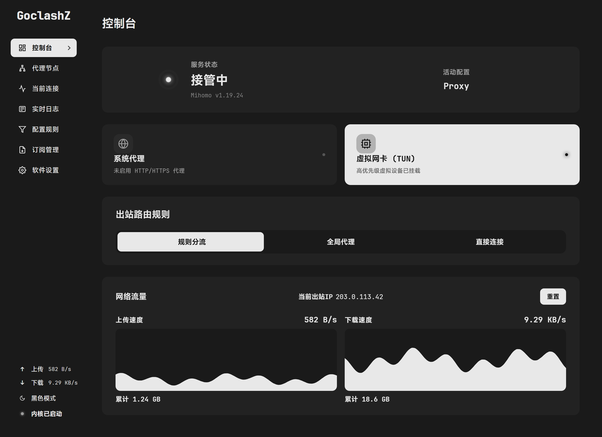
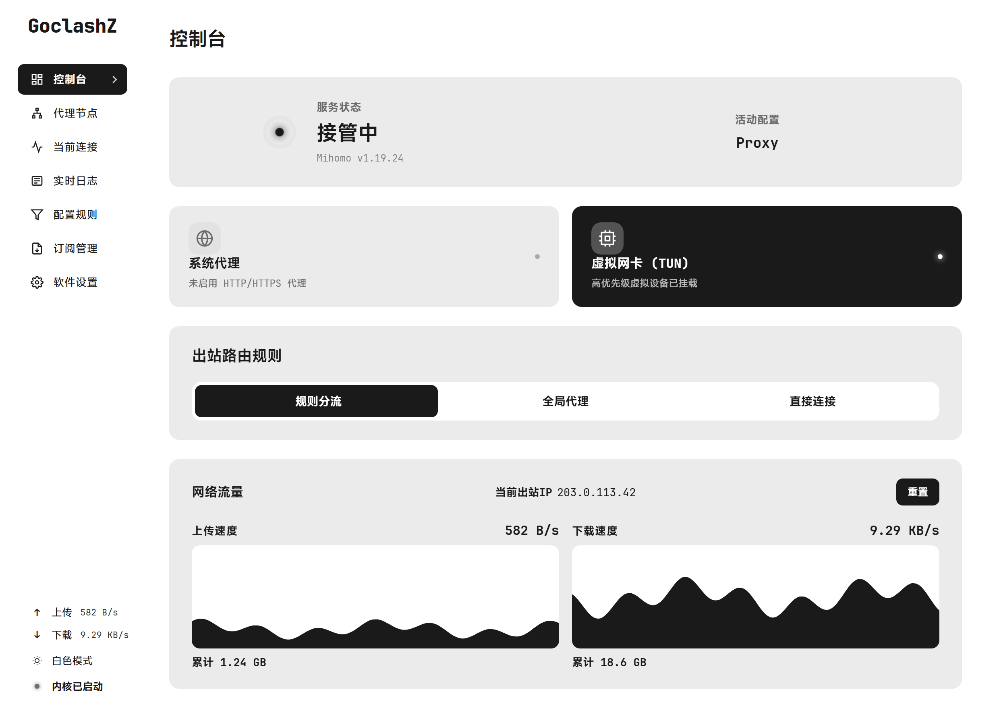
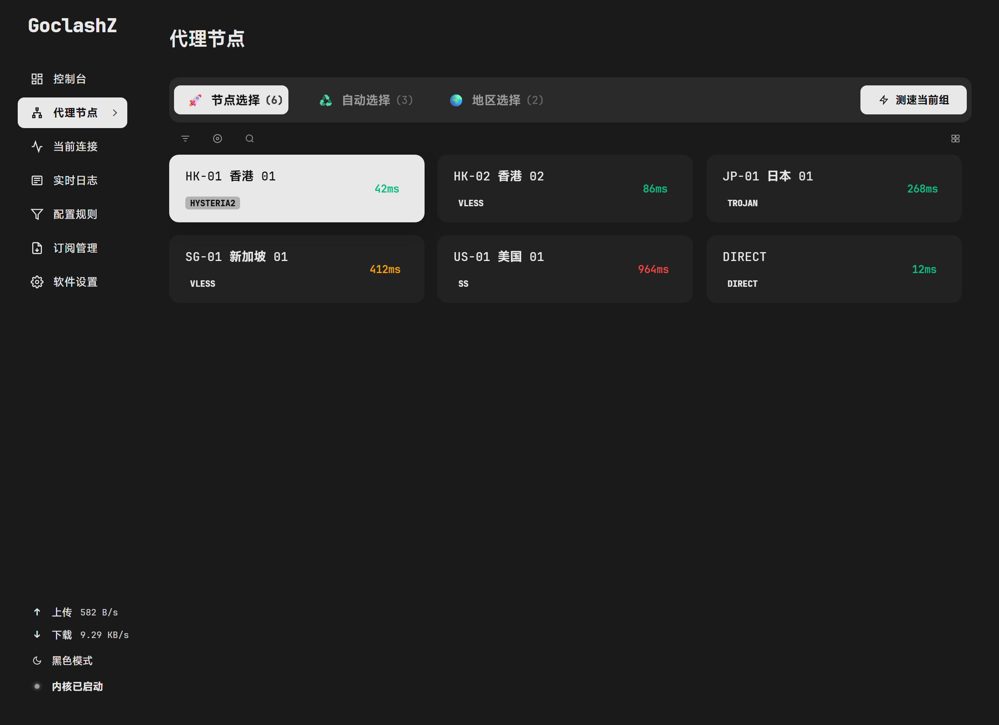
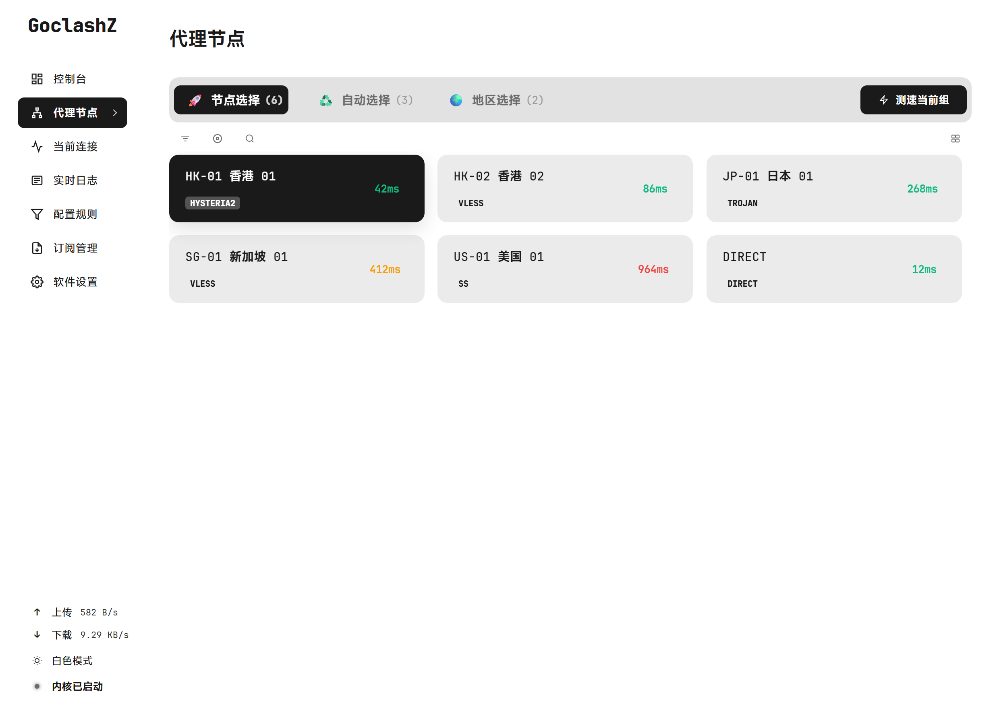
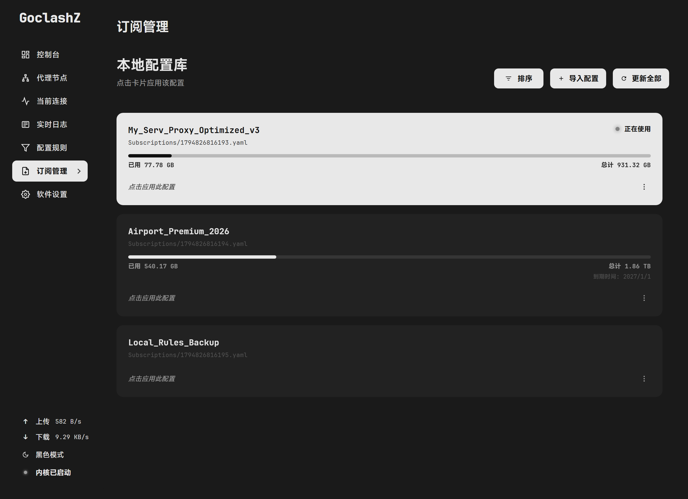
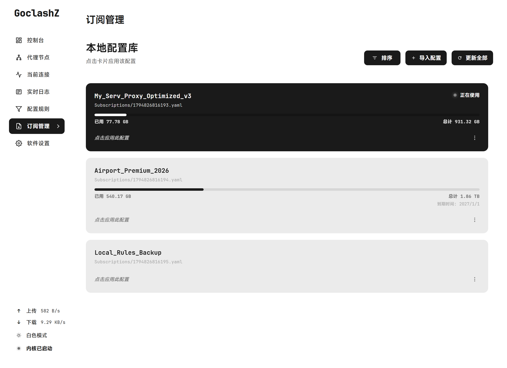

<!-- markdownlint-disable MD033 -->
#  GoclashZ

基于 Wails v3 构建的 Mihomo (Clash Meta) 桌面控制端，面向 Windows

   

<p align="center">
  <b>简体中文</b> | <a href="README_zh-TW.md">繁體中文（台灣）</a> | <a href="README_zh-HK.md">繁體中文（香港）</a> | <a href="README_en.md">English</a> | <a href="README_ja.md">日本語</a> | <a href="README_ru.md">Русский</a>
</p>

---

GoclashZ 是一个 Mihomo (Clash Meta) 的 Windows 桌面控制端。Go 承担内核编排与系统级操作，Vue 3 + WebView2 承担界面，二者通过 Wails v3 的绑定层通信。视觉上是黑白为主的实色面板，没有渐变与装饰性元素。

程序不打算做通用的跨平台客户端：只面向 Windows，托盘、热键、TUN、UWP 环回、系统代理都直接调用 Win32，不经过抽象层。

## 界面预览

| 深色模式 (Dark) | 浅色模式 (Light) |
| :---: | :---: |
|  |  |
|  |  |
|  |  |
<!-- markdownlint-enable MD033 -->

## 功能

### 网络接管

* **Helper 提权服务**：高权限操作（TUN 网卡、UWP 环回豁免、服务启停）交给独立的 `GoclashZHelper` 服务，通过 Named Pipe 与 SID 鉴权通信。主程序始终以普通用户权限运行，日常操作不会触发 UAC。
* **TUN 模式**：内置 Wintun 虚拟网卡的部署与状态检查，可对全系统流量做透明接管。
* **UWP 环回豁免**：解除 Windows Store 应用对本机代理端口的隔离限制。
* **局域网共享**：SOCKS5 / HTTP 端口、用户名密码认证、按 IP 的访问控制列表。
* **系统代理**：直接读写 Windows 注册表代理设置，切换即时生效。

### 性能与探测

* **出站地址探测**：IPv4 / IPv6 并发探测取首个有效结果；探测走内部代理端口，避免 TUN 模式下被直连误判。
* **节点测速**：按组批量测速，带并发上限与信号量控制；测速期间冻结排序快照，避免卡片跳动。
* **实时数据**：连接列表与流量走 WebSocket / Stream 推送，不轮询。
* **内核生命周期**：内核进程启动写入 PID，主程序退出时按进程镜像名校验后清理残留进程。

### 配置与状态

* **状态协调**：UI、托盘、后台自愈三条路径的控制意图统一经 ControlCoordinator 收敛，避免互相覆盖。
* **配置自愈**：升级或导入旧备份时，对缺失的新字段做内存级合并并落盘，配置文件可无损演进。
* **备份与还原**：`.gocz` 归档封装订阅、主题、网络与行为配置；还原支持全部 / 仅订阅（替换或合并）/ 仅设置四种模式，失败时回退到安全快照。
* **组件与 Geo 库更新**：内核、Wintun、GeoIP / GeoSite / MMDB / ASN 由统一调度器管理，下载支持断点续传，任务可并行、暂停、销毁。
* **原子写入**：配置与内核升级走「写 .tmp → 校验 → rename 覆盖」，避免中途断电损坏文件。

### 界面与交互

* **主题引擎**：12 套预设配色、自定义强调色、圆角三档、浅色 / 深色 / 跟随系统；首屏用本地缓存同步应用，不会先渲染默认主题再跳变。
* **8 种语言**：简体中文、繁體中文（台灣）、繁體中文（香港）、English、日本語、Русский、Français、Deutsch，文案与字段全量对齐；外语长词下侧栏宽度自动加宽，避免截断。
* **设置搜索**：10 个设置页共 103 个设置项统一索引，按页分组检索，点击直达并高亮定位。
* **应用诊断**：设置 → 关于 → 应用诊断，给出组件状态（Mihomo 内核 / Wintun / 内置种子）、六条目录路径与一键复制，可导出诊断包（版本、系统信息、脱敏配置、近三天日志）。
* **错误提示**：一句话结论 + 可展开的技术详情；成功类操作走轻提示，不打断当前操作。
* **空态**：列表为空时展示图标与说明，而不是单行灰字。
* **系统托盘**：托盘右键菜单跟随语言切换。

### 开机自启

* 通过注册表 Run 键实现用户登录自启，无需管理员权限。
* 全局热键 `Ctrl+Alt+Q` 可在托盘无响应时安全退出。

## 部署与使用

### 安装

从 [Releases](https://github.com/Zzz-IT/GoclashZ/releases) 下载对应版本安装包。

### 运行权限

主程序 `GoclashZ.exe` 在任何场景下都只需要普通用户权限。

需要 **TUN 虚拟网卡模式** 或修改 **UWP 网络隔离配置** 时，在设置页一键安装 `GoclashZHelper` 服务。该服务在后台以系统权限运行，与主程序通过 Named Pipe 和 SID 鉴权通信。

### 依赖

运行期依赖 WebView2（Windows 11 自带，安装器对老系统提供引导安装）。

## 工程目录结构

```text
GoclashZ/
├── main.go                        # 应用入口：Wails 创建、单实例互斥、崩溃恢复
├── app.go                         # App 绑定层，把 108 个方法路由到 core
├── services_v3_mapping.go         # Wails v3 Service 拆分（App/Core/Update）
├── tray_runtime_windows.go        # Win32 系统托盘与右键菜单
├── hotkey_windows.go              # 全局热键注册与响应
├── core/
│   ├── appcore/                   # 控制器、状态协调、事件调度、更新编排、诊断
│   ├── clash/                     # Mihomo 内核生命周期、配置构建、API 通信
│   ├── sys/                       # Windows 系统操作（代理、TUN、UWP、Helper、目录布局）
│   ├── runtimeassets/             # 运行组件资产状态与内置 seed 清单
│   ├── traffic/                   # 连接与流量的流式采集
│   ├── downloader/                # 断点续传下载与校验
│   ├── tasks/                     # 后台任务管理（去重、并发、取消）
│   ├── logger/                    # 日志缓冲与流式推送
│   ├── backup/                    # .gocz 归档打包与事务化还原
│   ├── jsonutil/                  # JSON 解析修补（配置自愈）
│   ├── utils/                     # 路径管理、设置持久化、进程工具
│   └── version/                   # 版本常量与解析
├── cmd/goclashz-helper/           # Helper 服务（高权限操作，Named Pipe + SID 鉴权）
└── frontend/
    └── src/
        ├── App.vue                # 根组件、事件监听、全局模态框
        ├── store.ts               # 响应式全局状态
        ├── components/            # 页面组件（Overview、Proxies、Connections、Settings 等）
        ├── settings/              # 设置项清单（搜索索引的单一数据源）
        ├── locales/               # 8 种语言文案
        └── styles/                # tokens / surfaces / layout
```

## 开发者指南

### 环境依赖

* Go 1.27.0 或更高
* Node.js 18 或更高
* Wails CLI v3.1+（`go install github.com/wailsapp/wails/v3/cmd/wails3@v3.1.0`）

### 构建

启动带热重载的本地开发服务器：

```bash
wails3 dev
```

编译 Windows 发行版：

```bash
wails3 build
```

安装包用 Inno Setup（`package.iss`）打包，发布流程见 `.github/workflows/release.yml`。前端构建前会跑两个校验脚本：`scripts/validate-settings-manifest.mjs`（设置项锚点与清单一致）、`scripts/check-i18n.mjs`（8 种语言 key 对齐）。

## 声明

* 本项目是个人出于对 Go 并发架构、系统级网络编程与桌面客户端的技术探索而写的自由软件，按 AGPLv3 原样提供。
* 开发者没有在任何社交平台、视频平台、论坛、即时通讯群组或电商渠道做过商业推广、引流或背书，也没有授权任何组织或个人代表本项目宣传或二次分发。
* 网络上第三方发布的介绍视频、推文、分发包、教程或商业行为，均属第三方独立行为，与开发者无关。
* 使用者应在遵守当地法律法规的前提下使用本软件；因使用、分发或依据第三方宣传使用而产生的风险与责任，由使用者自行承担。

## 开源协议

本项目采用 **GNU Affero General Public License v3.0（AGPLv3）** 发布，全文见 [`LICENSE`](LICENSE)。

与常见的宽松协议不同，AGPLv3 要求：如果你修改了本项目并**通过网络提供服务**（包括把它部署成在线服务、SaaS 或托管在服务器上供他人使用），你必须向这些用户提供对应版本的完整源码。仅在本地自用、或只做二进制分发而不提供网络服务的场景，也需随分发附带源码与协议文本。

> **注意**：`data/core/`、`build/runtime-assets/` 等目录下的 Mihomo 内核与 Geo 数据库文件来自 [MetaCubeX/mihomo](https://github.com/MetaCubeX/mihomo) 等上游项目，遵循各自的开源协议，不受本仓库 AGPLv3 约束。

## 致谢

* [Mihomo (Clash Meta)](https://github.com/MetaCubeX/mihomo) - 核心网络处理引擎
* [Wails](https://wails.io/) - Go + WebView2 桌面框架
* [go-ole](https://github.com/go-ole/go-ole) - Windows COM/OLE 接口绑定
* [systray](https://github.com/getlantern/systray) - 系统托盘交互组件
* 以及每一位提交 Issue、提出建议、参与讨论的用户与开发者。
