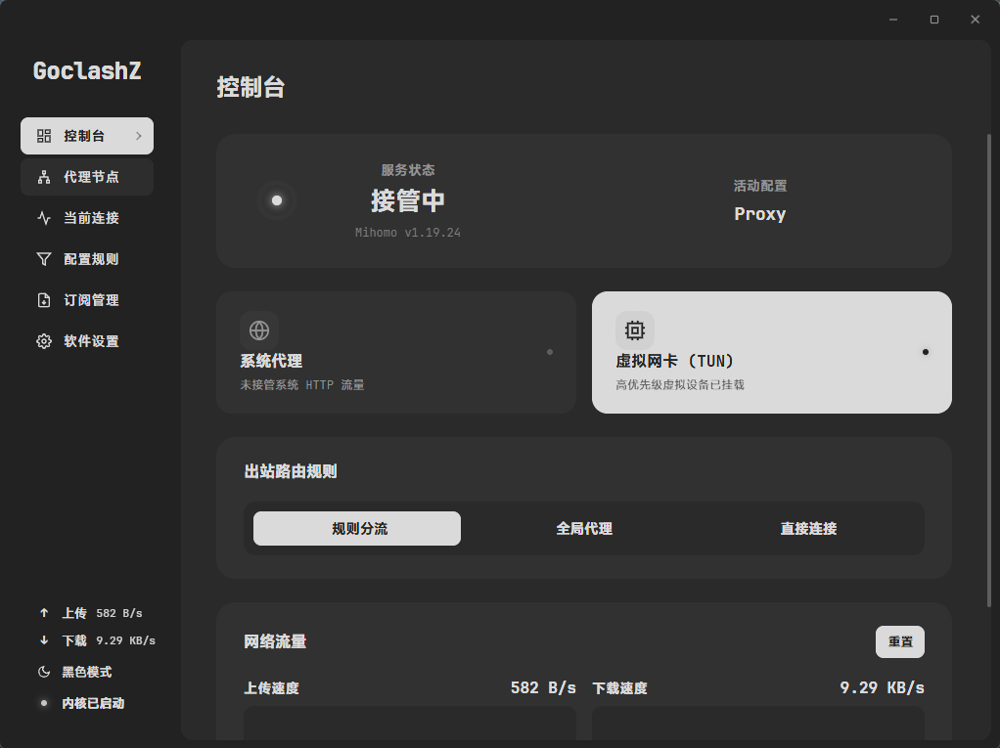
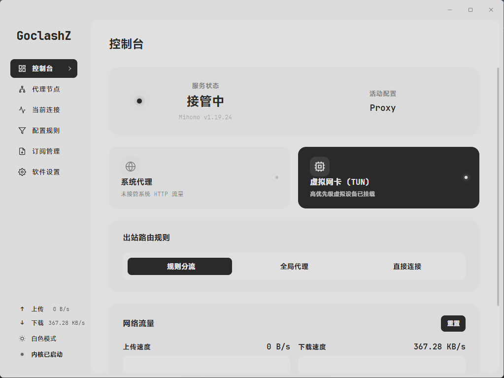
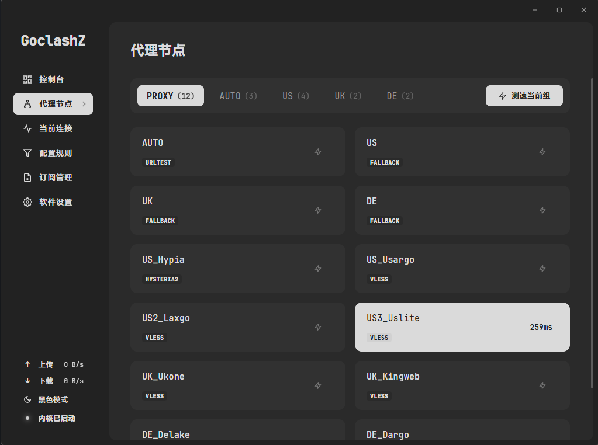
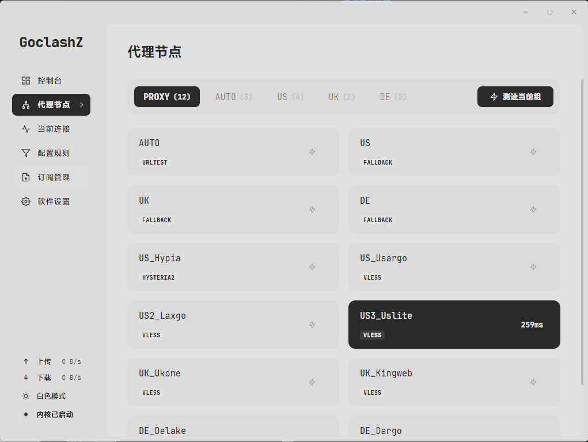
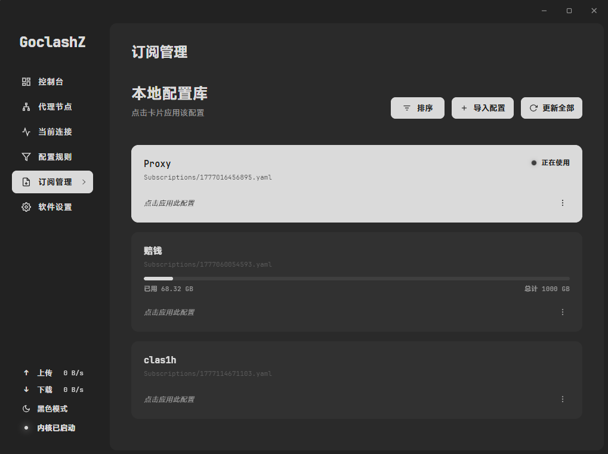
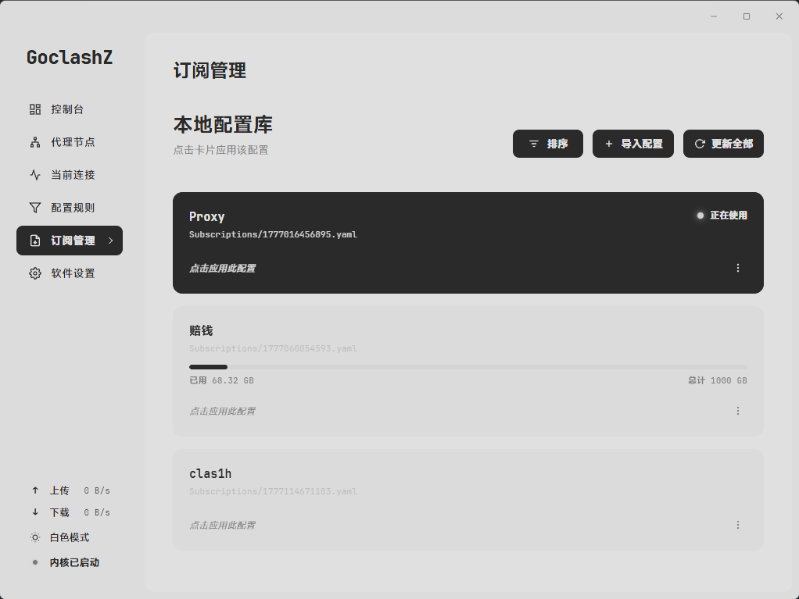

<!-- markdownlint-disable MD033 -->
#  GoclashZ

基於 Wails 構建的高性能、工業級實色美學 Mihomo (Clash Meta) 桌面控制端

   

<p align="center">
  <a href="README.md">简体中文</a> | <a href="README_zh-TW.md">繁體中文（台灣）</a> | <b>繁體中文（香港）</b> | <a href="README_en.md">English</a> | <a href="README_ja.md">日本語</a> | <a href="README_ru.md">Русский</a>
</p>

---

GoclashZ 誕生於對現代桌面應用過度臃腫的抗拒。本項目摒棄傳統 Electron 架構，利用 Go 語言的系統級並發能力與 Wails 的原生網頁視圖渲染，將內存佔用與系統資源消耗壓縮至極限。視覺層面堅持高對比度、黑白實色的極簡工業美學，剔除一切無意義的漸變與裝飾。它不只是一個控制界面，更是一套經過嚴苛加固的網絡狀態管理系統。

## 界面預覽

| 深色模式 (Dark) | 淺色模式 (Light) |
| :---: | :---: |
|  |  |
|  |  |
|  |  |
<!-- markdownlint-enable MD033 -->

## 核心功能

### 網絡接管與控制

* **獨立 Helper 提權架構**：引入完全隔離的本地後台服務（Named Pipe IPC），負責安全管控高權限操作（TUN 模式、UWP 解除、服務啟閉），主程式始終保持在普通用戶權限下運行。
* **智能 TUN 引擎**：內置 Wintun 虛擬網卡驅動的自動化部署與自愈機制，支援全系統網絡流量透明接管。
* **UWP 回環免除**：一鍵解除 Universal Windows Platform 應用的本地網絡隔離限制。
* **局域網共享與管控**：全面支援局域網代理共享，內置 SOCKS5 專屬端口管理、身份驗證及 IP 訪問控制列表 (ACL)。
* **系統代理管控**：精準控制 Windows 註冊表級代理設定，提供毫無延遲的路由切換體驗。

### 全面國際化與多語系支援 (i18n)

* **自研零依賴響應式引擎**：基於 Vue 3 響應式系統與本地儲存預熱，實現秒級無刷新切換，零第三方肥大套件負擔。
* **支援 8 大常用國際語系**：簡體中文、繁體中文（台灣）、繁體中文（香港）、English、日本語、Русский、Français、Deutsch 達成 100% 完整鍵值對齊。
* **智能自適應排版防禦**：外語長詞條下側邊欄寬度自動延展至 205px，搭配 Windows 原生字體回退鏈與表單防擠壓彈性佈局，徹底根絕文本截斷與組件變形。
* **全鏈路系統盤連動**：Windows 任務欄系統盤右鍵菜單即時同步多語言切換。

### 性能與並發探測

* **路由感知與雙棧探測**：出站測試強制通過內部代理端口，避免 TUN 模式下直連誤判。原生支援 IPv4 / IPv6 並發探測，提供極速真實出口地址偵測。
* **全局並發節流**：節點測速與更新鏈路引入信號量管理，防止通訊端耗盡與系統 I/O 阻塞。
* **流式監控引擎**：通過 WebSocket 與 Stream API 即時傳輸核心狀態，實現零延遲的連接拓撲與流量圖表展示。

### 配置與狀態管控

* **統一狀態協調器 (ControlCoordinator)**：消除多入口（UI、系統盤、看門狗）並發控制時的狀態覆蓋衝突。
* **配置自愈體系**：版本升級或匯入舊版備份時，自動修復缺失的新版欄位。
* **交易級防呆備份**：專有 `.gocz` 封裝格式，支援一鍵還原與自動快照備份。
* **原生註冊表自啟整合**：通過 Windows 原生 Run 註冊表鍵實現穩定開機自啟，告別 Task Scheduler 超時困擾。

### 診斷與可讀性
* **項目級設定搜尋**：8 個設定頁共 87 個設定項統一索引，按頁面分組檢索，點擊直達並高亮定位；
* **設定偏差回執**：儲存後提示不會按字面生效的設定項（端口衝突、認證缺失、協議棧限制），單條展開、多條摺疊；
* **DNS 解析解釋**：連接詳情顯示命中的名稱伺服器策略與解析器，無法靜態判定的場景明確標註；
* **分層錯誤提示**：一句話結論 + 可展開的技術細節，成功類操作改用輕提示不再打斷；
* **統一空態**：列表為空時顯示圖標與說明，替代單行灰字。

## 部署與安裝

訪問 [Releases](https://github.com/Zzz-IT/GoclashZ/releases) 頁面下載最新版本。

## 開發者指南

```bash
# 啟動熱重載開發服務器
wails dev

# 編譯 Windows 發行版可執行文件
wails build
```

## 聲明與後續計劃

### 社區致謝與免責聲明

* **衷心致謝**：衷心感謝所有使用 GoclashZ 以及在 GitHub 上積極提交 Issue、提出寶貴建議與參與技術討論的開發者及用戶。每一則回饋與關注都是推動本項目持續打磨、追求極致體驗的重要動力。
* **獨立開源與免責聲明**：
  1. 本項目（GoclashZ）純屬個人出於對 Go 語言並發架構、系統級網絡編程及桌面端輕量化美學的學術研究與技術探索所開發的自由開源工具，按 MIT 許可協議原樣提供。
  2. **開發者從未在任何第三方平台（包括但不限於各類社交媒體、影片平台、論壇社區、即時通訊群組或電商渠道）進行過任何形式的商業宣傳、推廣引流或背書，亦未授權任何組織或個人代表本項目進行宣傳與轉載分發**。
  3. 網絡上任何第三方發布關於本軟件的介紹影片、圖文、分發包、使用教程或商業行為，**均屬第三方獨立個人或機構的單方面行為，概與本軟件開發者無任何關係**。
  4. 用戶應在遵守當地法律法規的前提下合規使用本軟件。因使用、分發或依據第三方宣傳使用本軟件而產生的任何風險、責任與後果，**均由相關主體及用戶自行承擔，開發者不承擔任何直接、間接或連帶法律責任**。

### 並行計劃：轉向 Wails v3 架構，探索徹底擺脫 WebView2

為了追求更純粹的桌面原生體驗並徹底解決環境依賴痛點，項目近期計劃開設並行的實驗分支（全面轉向 **Wails v3** 架構）：

* **擺脫 WebView2 強依賴**：當前版本依賴 Windows 系統的 Microsoft Edge WebView2 運行時，部分精簡系統或老舊環境中常因缺少組件而影響開箱即用體驗。轉向 Wails v3 將深入探索解耦外部運行時、輕量化嵌入或原生渲染的技術可行性。
* **架構演進與系統深度整合**：善用 Wails v3 重構的跨平台原生視窗調度、無頭後台通訊與深度系統集成能力，進一步縮減內存與啟動耗時，打造真正開箱即用、完全零外部依賴的極簡控制端。

## 開源許可

本項目遵循 **MIT** 許可協議發布。
